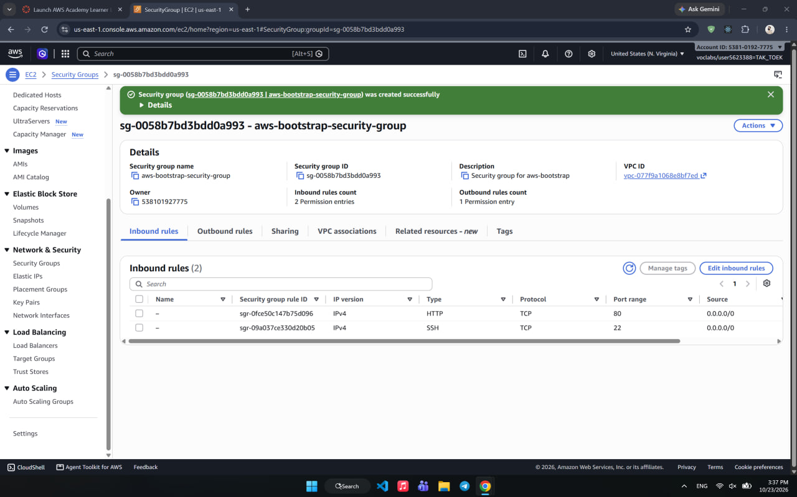
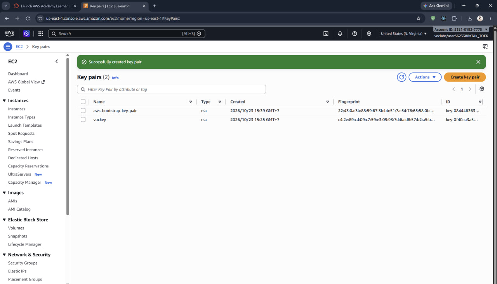
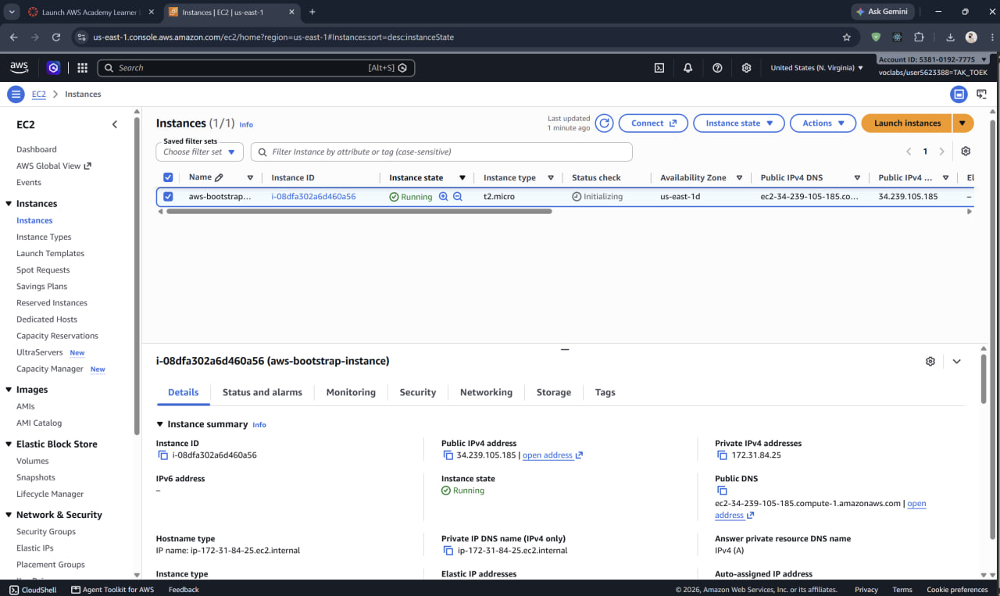
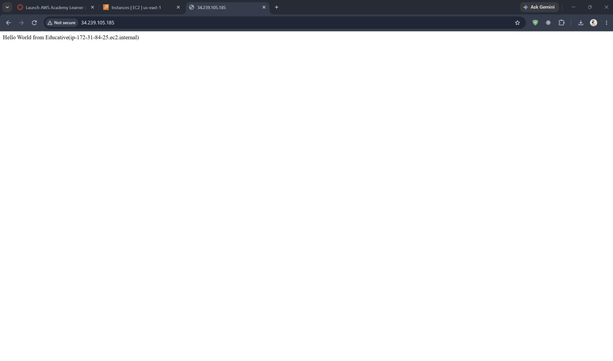
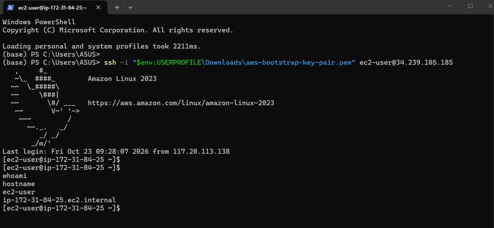
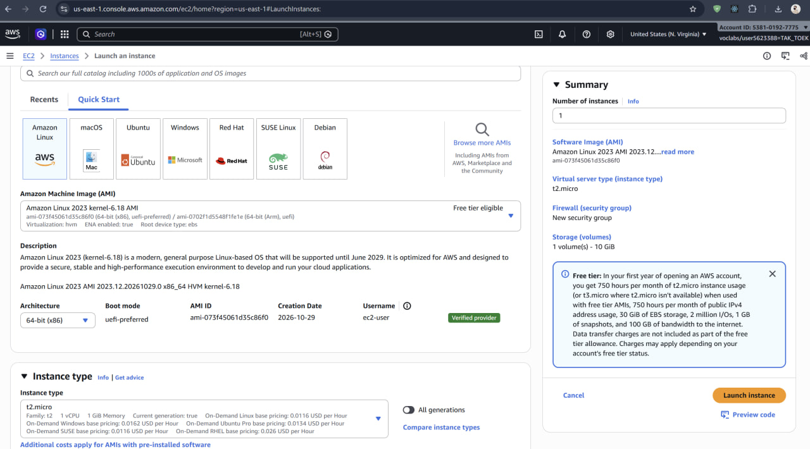
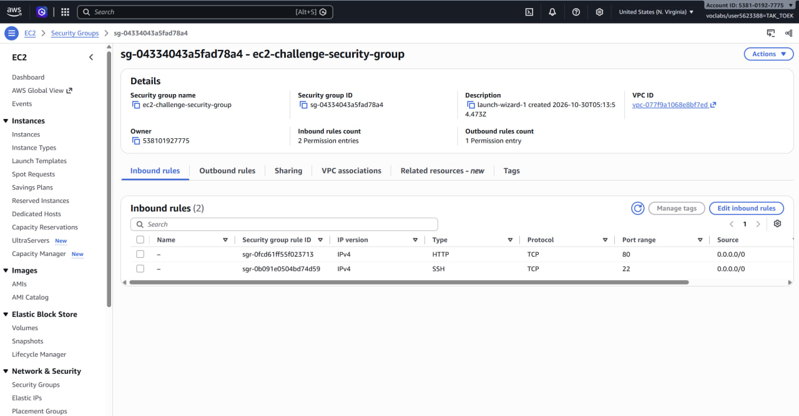
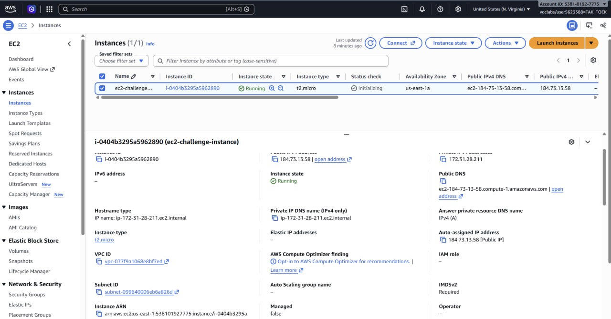
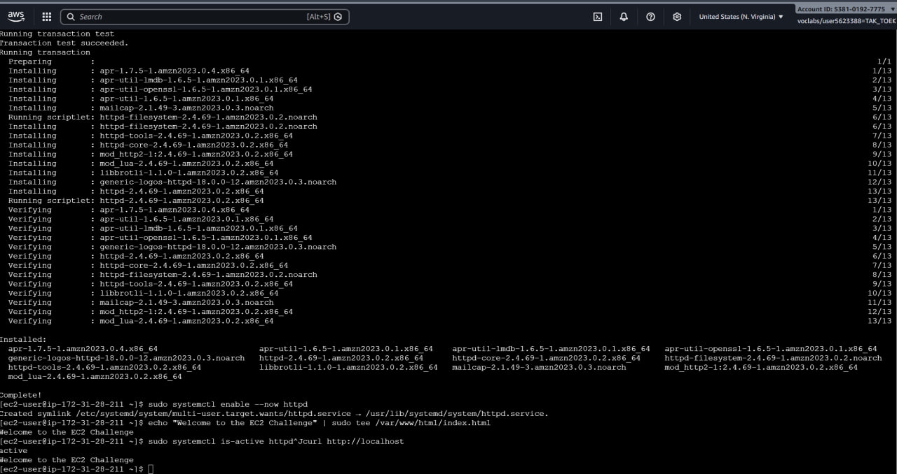
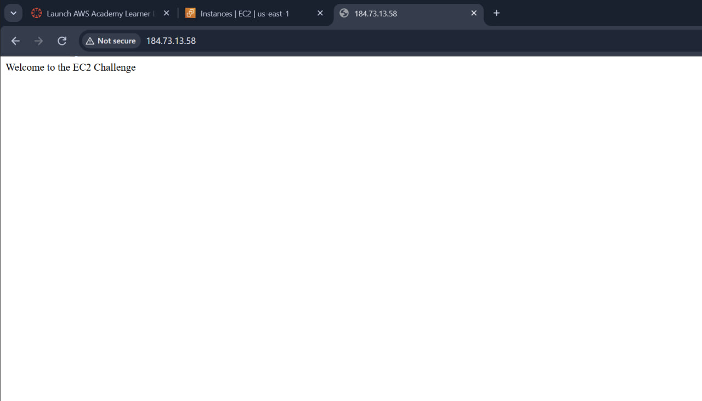

# Cloud Lab 1 - Amazon EC2

## Student Information
- Student ID: e20221669
- Course: Cloud Computing
- Lab: Cloud Lab 1 - Amazon EC2
- Region: US East (N. Virginia) (`us-east-1`)

## Part 1.1 - Amazon EC2 Walkthrough

**Status:** Completed

In this part, I created an EC2 instance using Amazon Linux 2023 with instance type `t2.micro` and 8 GiB storage. I configured a security group to allow HTTP (port 80) and SSH (port 22), created an RSA key pair, and launched the instance.

I tested the Apache web server and successfully displayed the message `Hello World from Educative(...)` using the public IPv4 address. I also connected to the instance using SSH from Windows PowerShell and verified the username and hostname.

The web server required manual installation and configuration after the initial user data script did not complete successfully.

After completing the tests and saving the screenshots, I terminated the EC2 instance and deleted the lab-created key pair and security group.

### Screenshots

## Cleanup

### Part 1.1 - EC2 Walkthrough

After completing the tasks and saving Screenshots 01–05, I cleaned up the AWS resources:

- Terminated `aws-bootstrap-instance`.
- Deleted `aws-bootstrap-key-pair`.
- Deleted `aws-bootstrap-security-group`.

## Part 1.2 - EC2 Challenge

After completing the challenge and saving Screenshots 06–10, I cleaned up the AWS resources:

- Terminated ec2-challenge-instance.

- Deleted ec2-challenge-key-pair.

- Deleted ec2-challenge-security-group.

### Screenshots

**Screenshot 06 - Challenge Launch**

**Screenshot 07 - Security Group**

**Screenshot 08 - Running Instance**

**Screenshot 09 - Apache Installation**

**Screenshot 10 - Browser Test**

