# Cloud Computing Lab 2
## Attach an Application Load Balancer to an EC2 Auto Scaling Group

**Name:** TAK Toek  
**Student ID:** e20221669  
**Course:** Cloud Computing  
**Platform:** AWS Academy Learner Lab  
**Region:** US East (N. Virginia) - us-east-1

## 1. Objective

The objective of this lab is to create an Application Load Balancer and an EC2 Auto Scaling Group. The load balancer distributes HTTP requests between EC2 instances, while Auto Scaling maintains the required number of instances and replaces unhealthy ones automatically.

## 2. Security Groups

Two security groups were created.

**LoadBalancerSecurityGroup**
- HTTP (Port 80): Anywhere-IPv4

**LaunchTemplateSecurityGroup**
- HTTP (Port 80): Anywhere-IPv4
- SSH (Port 22): Anywhere-IPv4

Both security groups use the default VPC.

**Screenshot 01: Load Balancer Security Group**

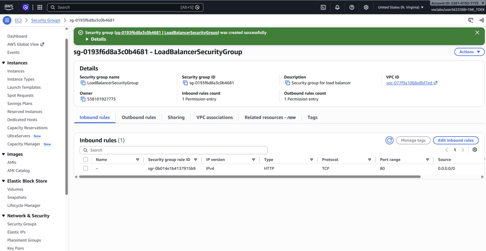

**Screenshot 02: Launch Template Security Group**

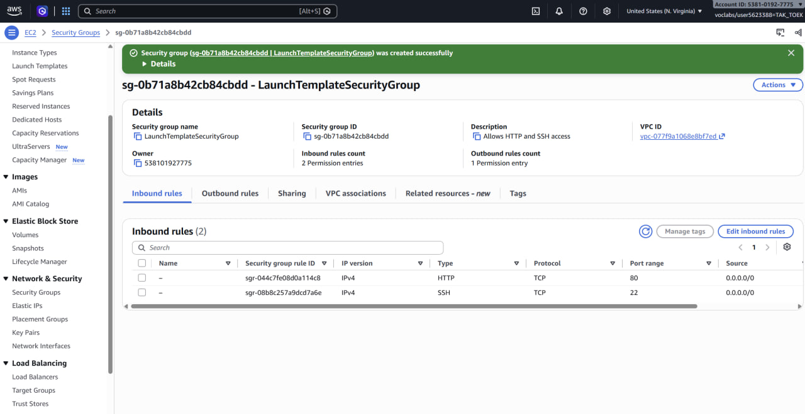

## 3. Target Group

Created a target group named `LoadBalancerTargetGroup`.

Configuration:
- Target type: Instances
- Protocol: HTTP
- Port: 80
- VPC: Default VPC
- Health check protocol: HTTP
- Health check path: /
- Success code: 200

Instances are registered automatically through the Auto Scaling Group.

**Screenshot 03: Target Group**

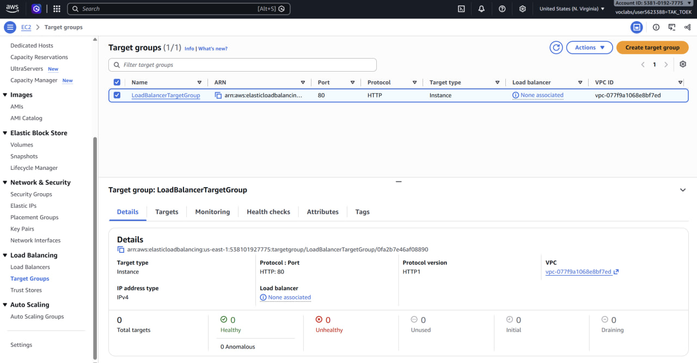

**Screenshot 04: Health Check Settings**

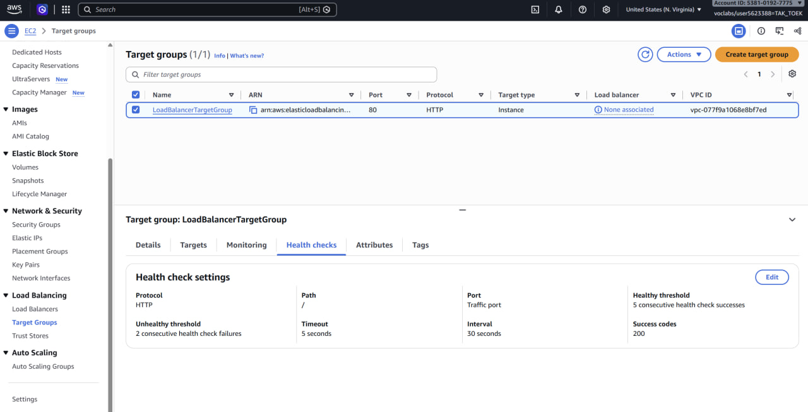

## 4. Application Load Balancer

Created an Application Load Balancer named `MyLoadBalancer`.

Configuration:
- Scheme: Internet-facing
- IP address type: IPv4
- VPC: Default VPC
- Availability Zones: 6
- Security group: LoadBalancerSecurityGroup
- Listener: HTTP, Port 80
- Target group: LoadBalancerTargetGroup

The load balancer was created successfully and became Active.

**Screenshot 05: Load Balancer List**

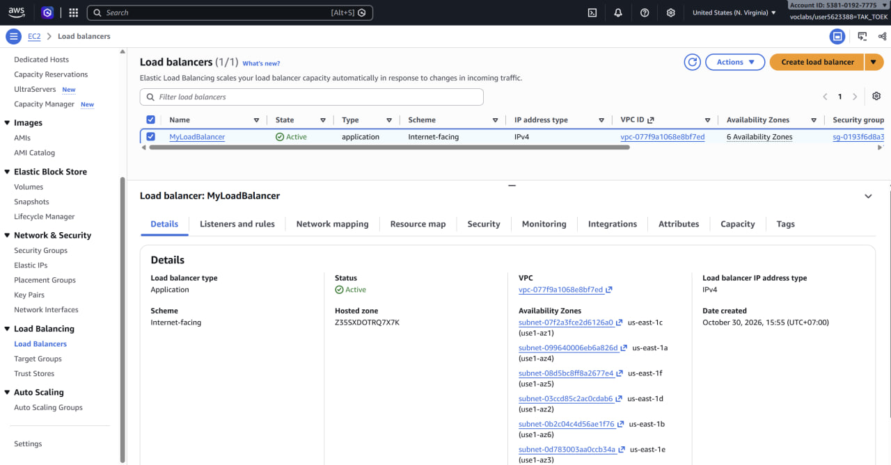

**Screenshot 06: Load Balancer Details**

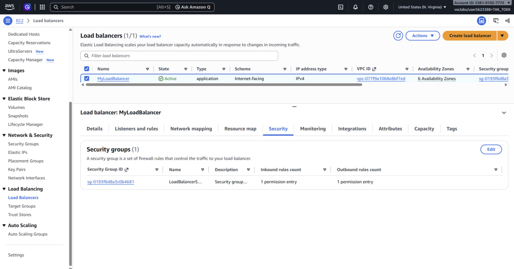

## 5. Launch Template

Created a launch template named `AutoScalingLaunchTemplate`.

Configuration:
- AMI: Amazon Linux 2023
- Instance type: t2.micro
- Security group: LaunchTemplateSecurityGroup
- Key pair: Not included
- User data: Install and start Apache HTTP Server

The final User data script used in Version 2 was:

```bash
#!/bin/bash
dnf install -y httpd
systemctl enable --now httpd
echo "Hello World from ($(hostname))" > /var/www/html/index.html
```

This script automatically installs Apache, starts the service, and creates a simple webpage displaying the EC2 hostname.

**Screenshot 07: Launch Template**

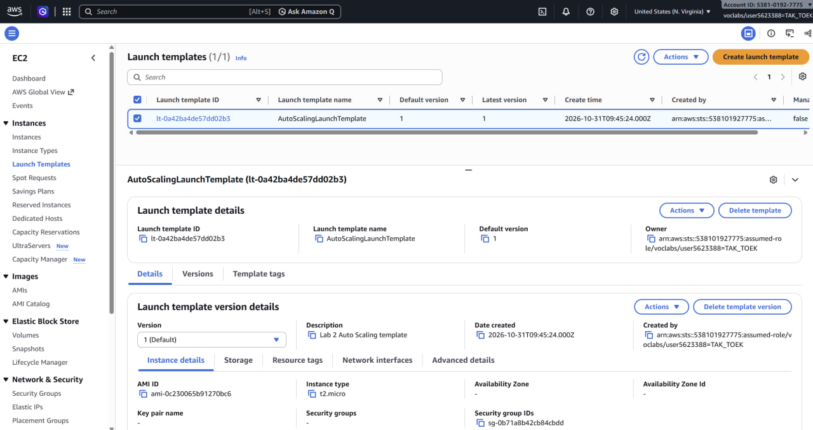

## 6. Auto Scaling Group

Created an Auto Scaling Group named `MyAutoScalingGroup`.

Configuration:
- Launch template: AutoScalingLaunchTemplate
- VPC: Default VPC
- Availability Zones: 6
- Target group: LoadBalancerTargetGroup
- Health checks: EC2 and ELB
- Health check grace period: 300 seconds
- Desired capacity: 2
- Minimum capacity: 2
- Maximum capacity: 3

The Auto Scaling Group automatically launched two EC2 instances.

**Screenshot 08: Auto Scaling Group List**

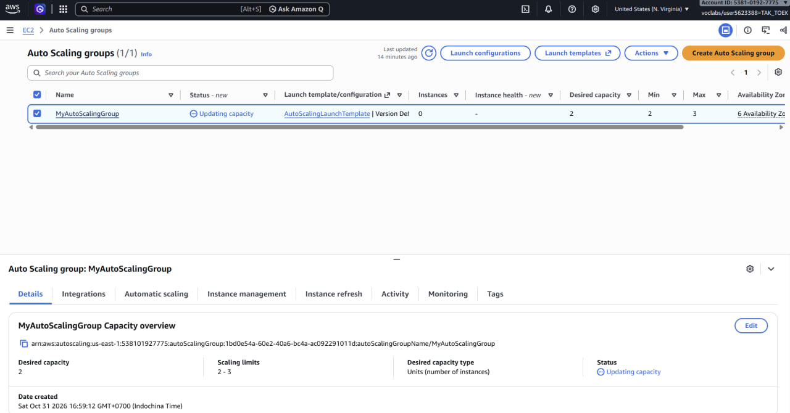

**Screenshot 09: Auto Scaling Group Details**

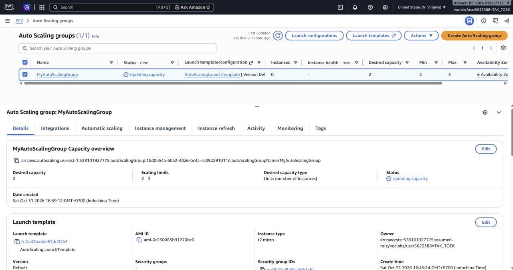

## 7. Load Balancer Testing

I opened the Load Balancer DNS address in a web browser using HTTP.

The webpage displayed:

**First instance:**

`Hello World from (ip-172-31-26-222.ec2.internal)`

**Second instance:**

`Hello World from (ip-172-31-37-183.ec2.internal)`

After refreshing the webpage, the hostname changed. This confirmed that the Application Load Balancer was distributing requests between different EC2 instances.

Both targets showed Healthy in the target group.

**Screenshot 10: First Instance Response**

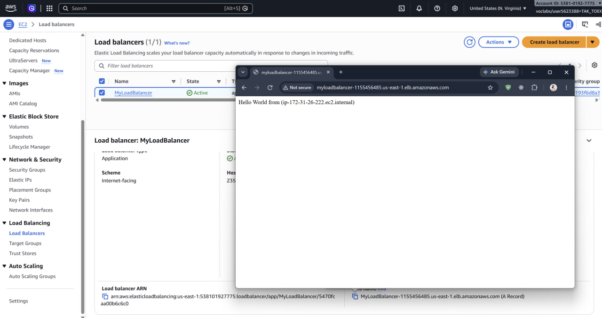

**Screenshot 11: Second Instance Response**

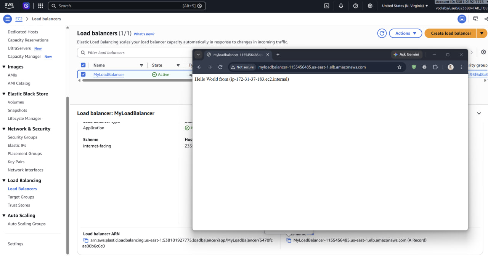

## 8. Testing Automatic Recovery

To test Auto Scaling recovery, I connected to one EC2 instance using EC2 Instance Connect.

I stopped Apache using:

```bash
sudo systemctl stop httpd.service
```

Then I checked the service status:

```bash
sudo systemctl status httpd.service --no-pager
```

The result showed:

`Active: inactive (dead)`

After Apache stopped, the target became unhealthy and entered the Draining state.

The Auto Scaling Group detected the failed health check and replaced the instance automatically.

After replacement, the target group returned to two Healthy targets.

**Screenshot 12: Stop Apache**

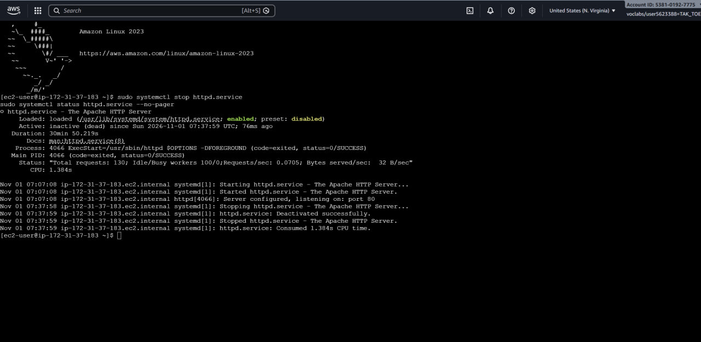

**Screenshot 13: Target Draining**

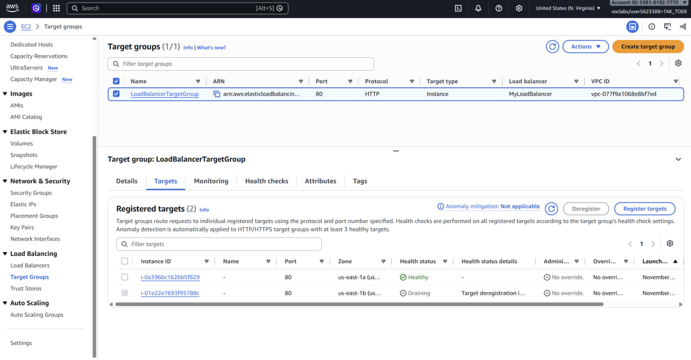

**Screenshot 14: Replaced Instance**

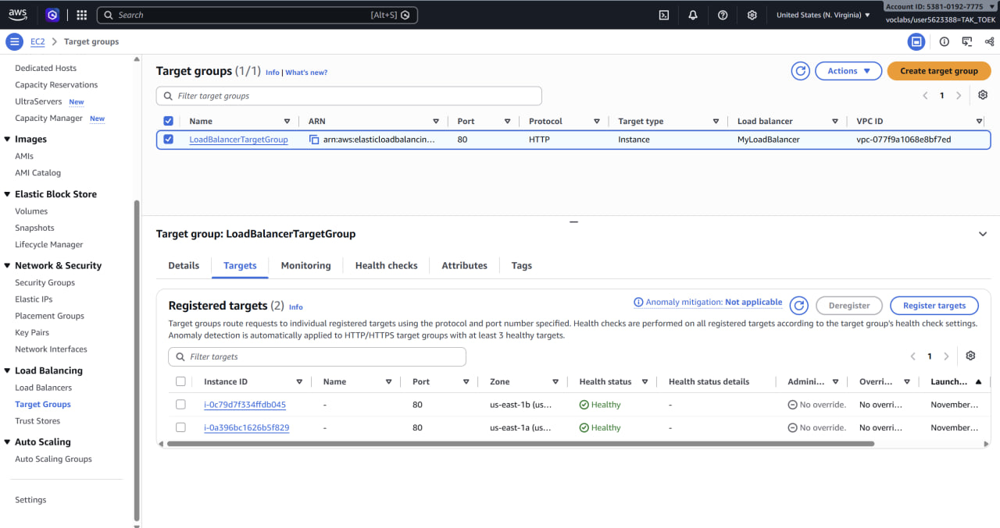

## 9. Problems and Solutions

During the lab, I encountered a problem where the EC2 instances failed their health checks.

After checking the Apache service, I found that HTTP Server was not installed automatically.

The cloud-init log displayed:

`Exec format error. Missing #! in script?`

This indicated that the User data script was not executed correctly.

To solve the problem, I corrected the User data script and created Launch Template Version 2.

I set Version 2 as the default version. Auto Scaling then launched new instances using the corrected configuration.

After that, Apache started successfully and both instances passed their health checks.

I also encountered an AWS Academy permission restriction when attempting to use Instance Refresh, so I relied on Auto Scaling's automatic unhealthy-instance replacement instead.

## 10. Cleanup

After completing the tests, I performed the AWS cleanup.

Resources included:
1. MyAutoScalingGroup
2. AutoScalingLaunchTemplate
3. MyLoadBalancer
4. LoadBalancerTargetGroup
5. LoadBalancerSecurityGroup
6. LaunchTemplateSecurityGroup

The AWS Academy Learner Lab session was then ended.

## 11. Conclusion

In this lab, I learned how to configure an Application Load Balancer and an EC2 Auto Scaling Group.

The load balancer successfully distributed HTTP requests between two EC2 instances. Auto Scaling detected a failed web server and replaced the unhealthy instance automatically.

This lab demonstrated how load balancing and Auto Scaling improve application availability and reliability.
