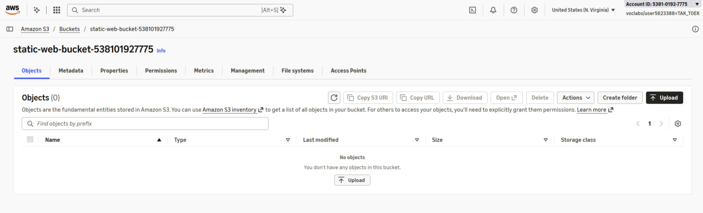
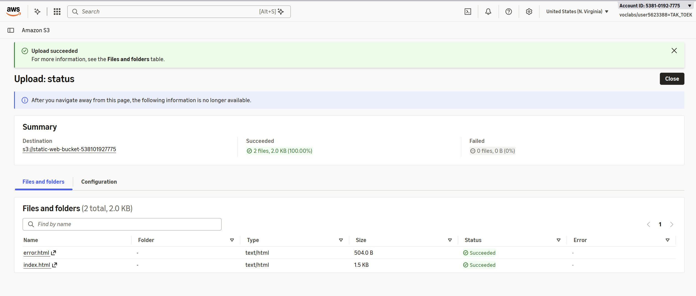
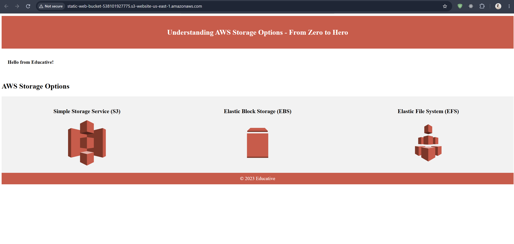
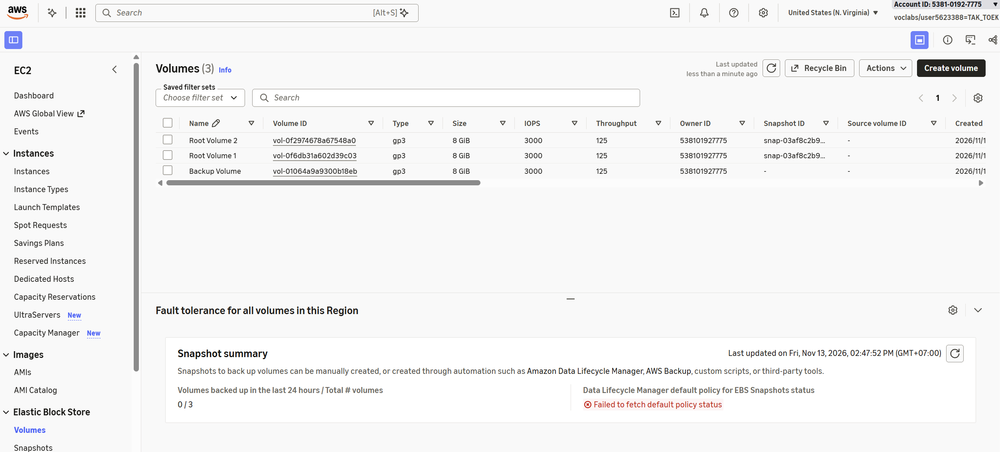
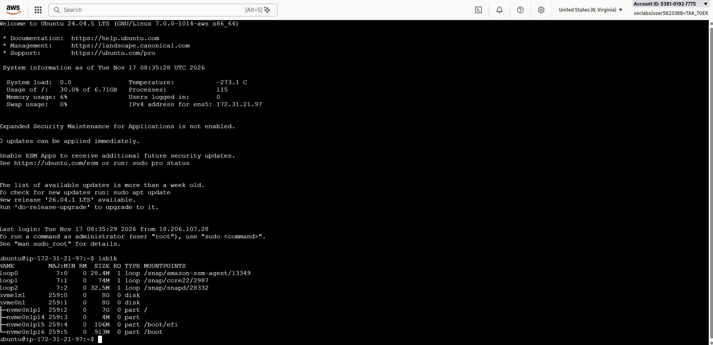
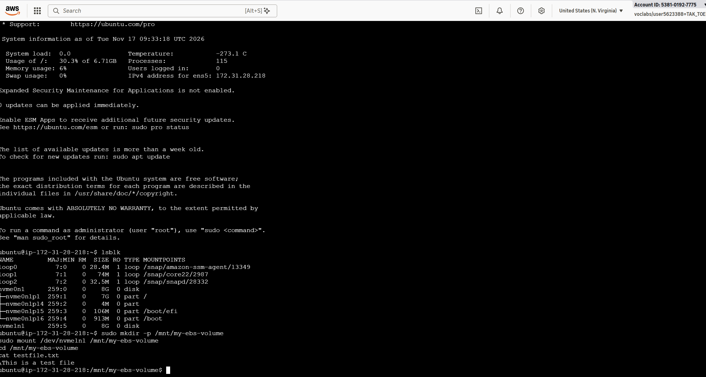
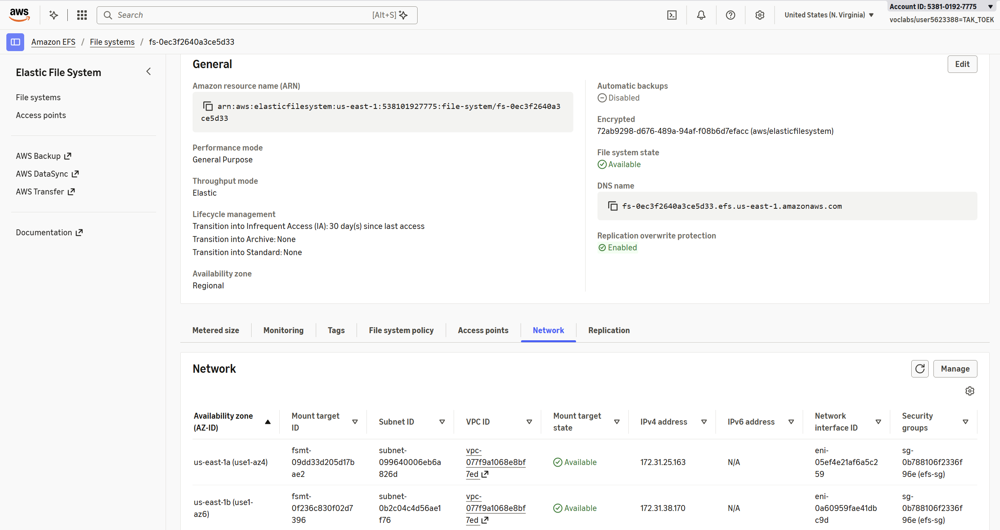
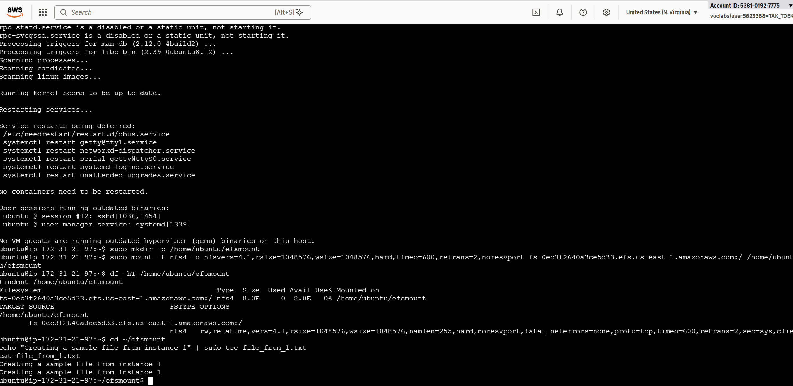
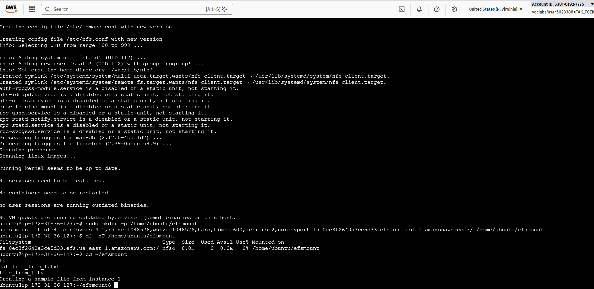

# Cloud Computing  Lab 3: Understanding AWS Storage Options

## 1. Lab Information

- **Lab:** Lab 3 — Understanding AWS Storage Options
- **Platform:** AWS Academy Learner Lab
- **AWS Region:** US East (N. Virginia) — `us-east-1`
- **Work Type:** Individual
- **AWS Services:** Amazon S3, Amazon EBS, Amazon EFS, Amazon EC2

## 2. Lab Objectives

The objectives of this lab are to:

1. Create an Amazon S3 bucket, upload objects, and host a static website.
2. Create an Amazon EBS volume, attach and mount it to an EC2 instance, and transfer it to another instance.
3. Create an Amazon EFS file system and share files between two EC2 instances.
4. Understand the differences between object, block, and file storage.

---

## 3. Part 2.1 — Amazon Simple Storage Service (S3)

### 3.1 Create an S3 Bucket

Created an S3 bucket with the following configuration:

| Setting | Value |
|---|---|
| Bucket name | `static-web-bucket-538101927775` |
| Region | `us-east-1` |
| Block Public Access | Disabled for website hosting |
| Object Ownership | Default |

**Result:** The S3 bucket was created successfully.

**Screenshot 01 — S3 Bucket List**



### 3.2 Upload Website Files

Created and uploaded two HTML files:

- `index.html` — Main static webpage introducing AWS storage services.
- `error.html` — Custom error webpage.

Both objects were uploaded to the S3 bucket.

**Result:** The bucket successfully stored both HTML files.

**Screenshot 02 — S3 Objects**



### 3.3 Enable Static Website Hosting

Configured static website hosting using:

| Setting | Value |
|---|---|
| Static website hosting | Enabled |
| Hosting type | Host a static website |
| Index document | `index.html` |
| Error document | `error.html` |

Added a bucket policy allowing public read access to website objects.

```json
{
  "Version": "2012-10-17",
  "Statement": [
    {
      "Sid": "Statement1",
      "Effect": "Allow",
      "Principal": "*",
      "Action": "s3:GetObject",
      "Resource": "arn:aws:s3:::static-web-bucket-538101927775/*"
    }
  ]
}
```

**Result:** The static website was successfully accessed through its S3 website endpoint.

**Screenshot 03 — Static Website**



---

## 4. Part 2.2 — Amazon Elastic Block Store (EBS)

### 4.1 Launch EC2 Instances

Launched two Ubuntu EC2 instances with the following configuration:

| Setting | Value |
|---|---|
| Instance names | `instance-1`, `instance-2` |
| AMI | Ubuntu Server 24.04 LTS |
| Instance type | `t3.medium` |
| Availability Zone | `us-east-1a` |
| Security group | `ec2instances-sg` |
| Root volume | 8 GiB gp3 |

The security group allowed inbound SSH traffic on TCP port 22 for lab access.

**Result:** Both EC2 instances were launched and running successfully.

### 4.2 Create and Attach an EBS Volume

Created an additional EBS volume:

| Setting | Value |
|---|---|
| Volume name | `Backup Volume` |
| Volume type | General Purpose SSD (gp3) |
| Size | 8 GiB |
| Availability Zone | `us-east-1a` |
| Initial attachment | `instance-1` |
| Device name requested | `/dev/sdf` |

The volume appeared as `/dev/nvme1n1` in Ubuntu.

**Result:** The Backup Volume was attached successfully with the state `In-use`.

**Screenshot 04 — EBS Volumes**



### 4.3 Format and Mount the EBS Volume

Connected to `instance-1` using EC2 Instance Connect.

Listed the attached block devices:

```bash
lsblk
```

The output identified:

- `/dev/nvme0n1` — Root volume.
- `/dev/nvme1n1` — Additional 8 GiB Backup Volume.

**Screenshot 05 — Attached EBS Volume**



Formatted and mounted the additional volume:

```bash
sudo mkfs -t ext4 /dev/nvme1n1
sudo mkdir -p /mnt/my-ebs-volume
sudo mount /dev/nvme1n1 /mnt/my-ebs-volume
```

Created and verified a test file:

```bash
cd /mnt/my-ebs-volume
echo "This is a test file" | sudo tee testfile.txt
cat testfile.txt
```

**Output:**

```text
This is a test file
```

**Result:** The EBS volume was formatted, mounted, and used to store a file successfully.

### 4.4 Transfer the EBS Volume to Another Instance

Unmounted the volume from `instance-1`:

```bash
cd ~
sudo umount -l /mnt/my-ebs-volume
```

Detached the Backup Volume using the AWS EC2 console and attached it to `instance-2`.

Connected to `instance-2` and mounted the existing volume without reformatting:

```bash
lsblk
sudo mkdir -p /mnt/my-ebs-volume
sudo mount /dev/nvme1n1 /mnt/my-ebs-volume
cd /mnt/my-ebs-volume
cat testfile.txt
```

**Output:**

```text
This is a test file
```

**Result:** The file remained accessible after transferring the EBS volume from `instance-1` to `instance-2`, demonstrating data persistence.

**Screenshot 06 — EBS Volume on Second Instance**



---

## 5. Part 2.3 — Amazon Elastic File System (EFS)

### 5.1 Create an EFS File System

Created a new EFS file system with the following configuration:

| Setting | Value |
|---|---|
| Name | `clab-efs` |
| File system ID | `fs-0ec3f2640a3ce5d33` |
| Region | `us-east-1` |
| File system type | Regional |
| Encryption | Enabled |
| Automatic backups | Disabled |
| Throughput mode | Elastic |
| Security group | `efs-sg` |

Configured two EFS mount targets:

- `us-east-1a`
- `us-east-1b`

The `efs-sg` security group was configured to allow NFS traffic on TCP port 2049.

**Result:** The EFS file system and its two mount targets were created.

**Screenshot 07 — EFS File System and Mount Targets**



### 5.2 Launch the Third EC2 Instance

Launched `instance-3` with the following configuration:

| Setting | Value |
|---|---|
| Instance name | `instance-3` |
| AMI | Ubuntu Server 24.04 LTS |
| Instance type | `t3.medium` |
| Availability Zone | `us-east-1b` |
| Security group | `ec2instances-sg` |
| Root volume | 8 GiB gp3 |

The EFS file system was accessed from:

- `instance-1` in `us-east-1a`
- `instance-3` in `us-east-1b`

### 5.3 Mount EFS on instance-1

Initially attempted to install `amazon-efs-utils` by building it from source, as specified in the lab.

The build encountered dependency errors and eventually failed because the EC2 root volume ran out of disk space.

To complete the file-sharing exercise, the standard Linux NFS client was used instead.

Installed the NFS client:

```bash
sudo apt-get update
sudo apt-get install -y nfs-common
```

Created the mount directory:

```bash
sudo mkdir -p /home/ubuntu/efsmount
```

Mounted the EFS file system:

```bash
sudo mount -t nfs4 \
  -o nfsvers=4.1,rsize=1048576,wsize=1048576,hard,timeo=600,retrans=2,noresvport \
  fs-0ec3f2640a3ce5d33.efs.us-east-1.amazonaws.com:/ \
  /home/ubuntu/efsmount
```

Verified the mount:

```bash
df -hT /home/ubuntu/efsmount
findmnt /home/ubuntu/efsmount
```

**Result:** EFS was successfully mounted on `instance-1` using NFSv4.

### 5.4 Create a File on instance-1

Created a sample file inside the EFS mount directory:

```bash
cd ~/efsmount
echo "Creating a sample file from instance 1" | sudo tee file_from_1.txt
cat file_from_1.txt
```

**Output:**

```text
Creating a sample file from instance 1
```

**Result:** The sample file was successfully written to the shared EFS file system.

**Screenshot 08 — Write File to EFS**



### 5.5 Mount EFS on instance-3 and Read the Shared File

Connected to `instance-3` using EC2 Instance Connect.

Installed the NFS client:

```bash
sudo apt-get update
sudo apt-get install -y nfs-common
```

Created the mount directory:

```bash
sudo mkdir -p /home/ubuntu/efsmount
```

Mounted the same EFS file system:

```bash
sudo mount -t nfs4 \
  -o nfsvers=4.1,rsize=1048576,wsize=1048576,hard,timeo=600,retrans=2,noresvport \
  fs-0ec3f2640a3ce5d33.efs.us-east-1.amazonaws.com:/ \
  /home/ubuntu/efsmount
```

Verified the mount and read the shared file:

```bash
df -hT /home/ubuntu/efsmount
cd ~/efsmount
ls
cat file_from_1.txt
```

**Output:**

```text
file_from_1.txt
Creating a sample file from instance 1
```

**Result:** The file created on `instance-1` was successfully accessed from `instance-3`, demonstrating shared file storage across two Availability Zones.

**Screenshot 09 — Read Shared EFS File**



---

## 6. Comparison of AWS Storage Services

| Feature | Amazon S3 | Amazon EBS | Amazon EFS |
|---|---|---|---|
| Storage type | Object | Block | File |
| Access method | S3 API / HTTP | Attached block device | NFS |
| Main use case | Static websites, backups, objects | EC2 disks, databases | Shared files |
| Scaling | Highly scalable | Volume-based | Automatically scalable |
| Sharing | Access through APIs | Typically attached to one instance | Multiple instances simultaneously |
| Data persistence | Independent of EC2 | Independent of EC2 when retained | Independent of EC2 |

### Key Differences

**Amazon S3:** Best suited for storing and retrieving objects, including static website files, images, backups, and logs.

**Amazon EBS:** Provides block storage for EC2 instances. A volume can retain its data after being detached and attached to another instance in the same Availability Zone.

**Amazon EFS:** Provides shared file storage that multiple EC2 instances can mount and access simultaneously.

---

## 7. Challenges and Solutions

### Challenge 1 — EFS Client Build Dependencies

Building `amazon-efs-utils` initially failed because the installed Cargo version could not read the newer `Cargo.lock` format.

**Solution:** Installed a newer Rust toolchain through `rustup`.

### Challenge 2 — Missing Build Dependencies

The subsequent builds reported missing CMake and Go dependencies.

**Solution:** Installed `cmake` and `golang-go`.

### Challenge 3 — Insufficient Disk Space

The EFS client build eventually failed with:

```text
No space left on device
```

**Solution:** Removed failed build artifacts and used `nfs-common` to mount EFS directly through NFSv4.1.

This alternative successfully demonstrated shared file access. Unlike the EFS mount helper, the direct NFS mount used in this lab did not enable encryption in transit.

---

## 8. Conclusion

This lab provided hands-on experience with three AWS storage services: Amazon S3, Amazon EBS, and Amazon EFS.

- **Amazon S3:** Successfully hosted a static website using uploaded HTML files and a bucket policy.
- **Amazon EBS:** Successfully created, mounted, and transferred an EBS volume between two EC2 instances while preserving its data.
- **Amazon EFS:** Successfully shared a file between two EC2 instances in different Availability Zones using NFS.

The lab demonstrated how AWS storage services support different requirements, including object storage, persistent block storage, and shared file storage.

All three hands-on sections were completed successfully, with nine screenshots collected as evidence.
