# Cloud Lab 4 Submission — Amazon VPC

This report follows the [Lab 4 instructions](https://github.com/RathpiseyAlpha/ITC-I5GIC-CC/blob/main/labs/lab4/lab4-instruction.md). All resources were configured in US East (N. Virginia), `us-east-1`.

- **Student name:** Tak Toek
- **Student ID:** e20221669
- **Learner Lab user name:** voclabs/user5623388=TAK_TOEK
- **Date completed:** 2026-11-06

---

## VPC and internet gateway

### 1. VPC

Created `lab4-vpc` with IPv4 CIDR block `10.0.0.0/24`.

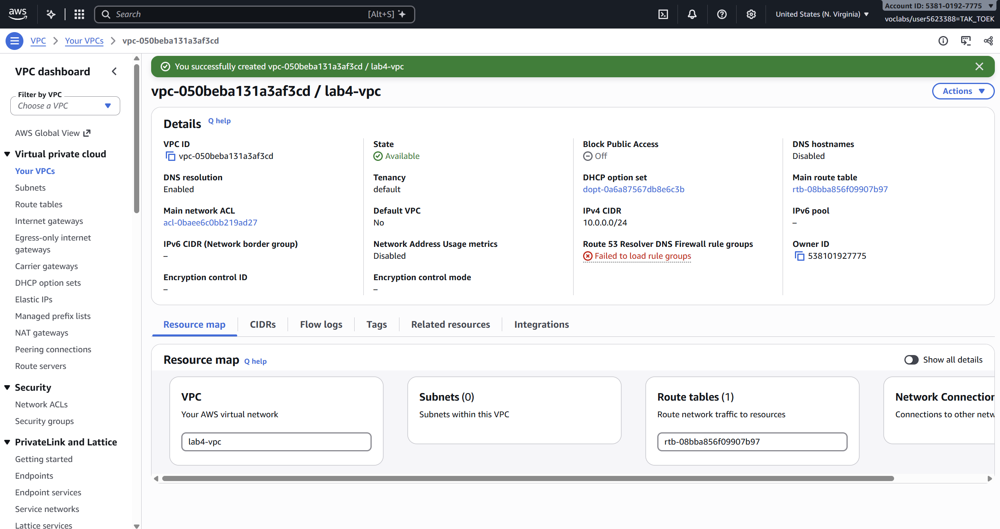

### 2. Internet gateway

Created `lab4-internet-gateway` and attached it to `lab4-vpc`.

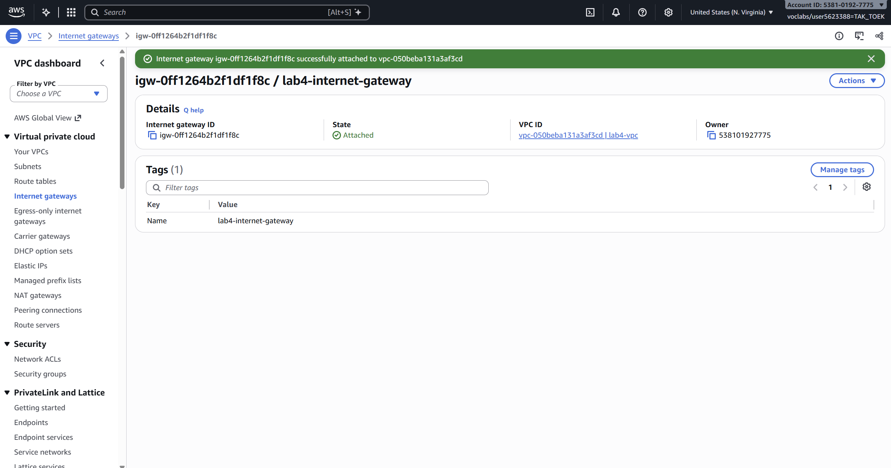

## Public subnet

### 3. Public subnet

Created `lab4-public-subnet` with CIDR `10.0.0.0/25` in `us-east-1a`.

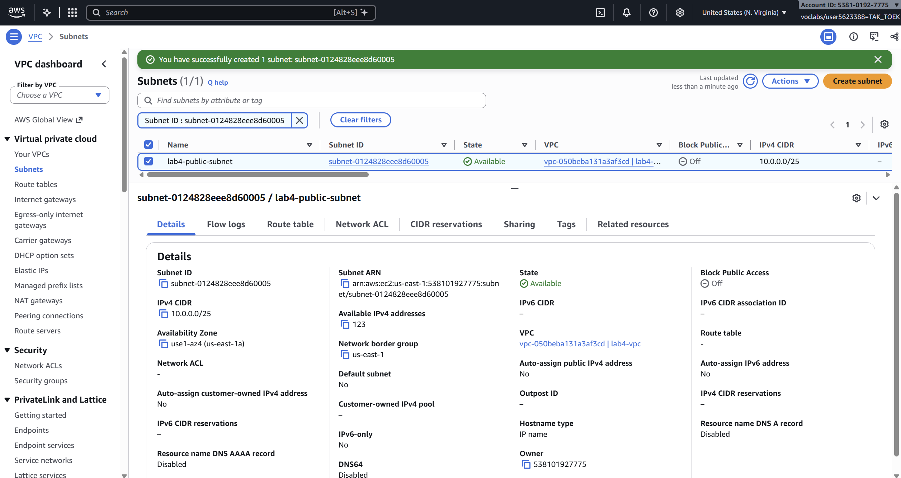

### 4. Public route table

Added `0.0.0.0/0` pointing to `lab4-internet-gateway` and explicitly associated the route table with `lab4-public-subnet`. The existing `10.0.0.0/24 → local` route allows communication within the VPC.

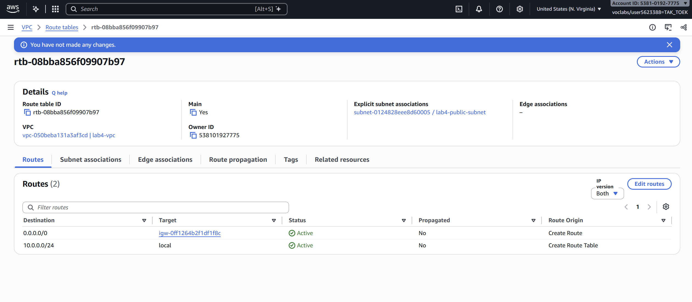

### 5. EC2 instance in the public subnet

Launched `lab4-ec2-01` in `lab4-public-subnet` with a public IPv4 address, instance type `t2.micro`, 8 GiB gp2 storage, and IAM instance profile `LabInstanceProfile`. No key pair or inbound security group rules were configured.

**AMI substitution:** Used Amazon Linux 2023, 64-bit (x86), because Amazon Linux 2 was unavailable in the AMI selector. This differs from the AMI specified in the lab instructions.

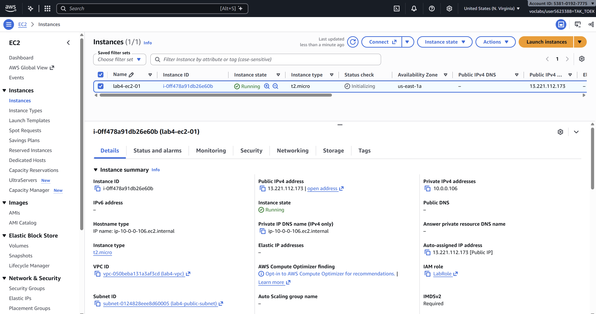

### 6. Internet test from the public subnet

Used Systems Manager Run Command with the `AWS-RunShellScript` document to run the following command on `lab4-ec2-01`, with S3 output disabled:

```bash
sudo yum update -y
```

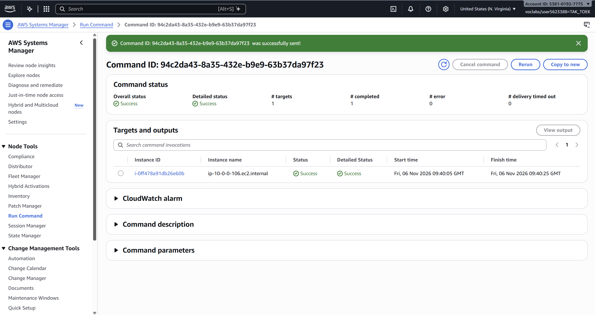

## Private subnet

### 7. Private subnet

Created `lab4-private-subnet` with CIDR `10.0.0.128/25` in `us-east-1a`.

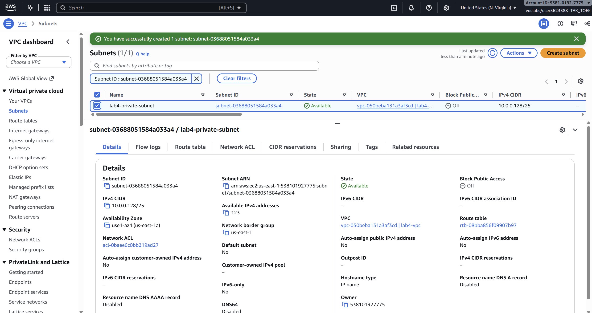

### 8. NAT gateway

Created `lab4-nat-gateway` in `lab4-public-subnet`, using **Zonal** availability mode, **Public** connectivity, and an allocated Elastic IP address. Waited for its state to become **Available**.

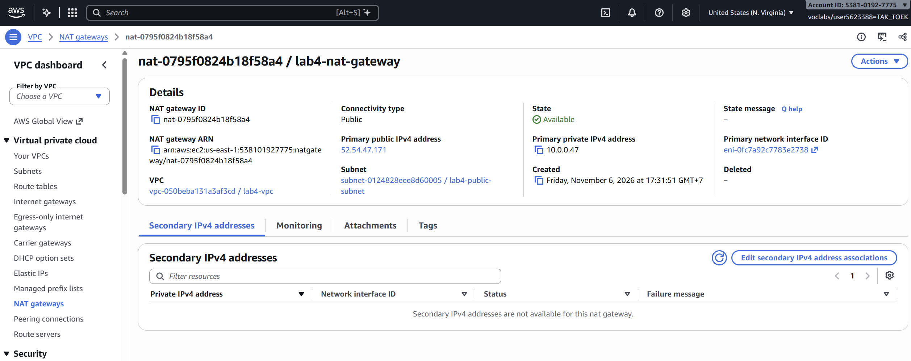

### 9. Private route table

Created `lab4-custom-route-table` in `lab4-vpc`. Added `0.0.0.0/0 → lab4-nat-gateway` and explicitly associated this table with `lab4-private-subnet`. Kept the local VPC route.

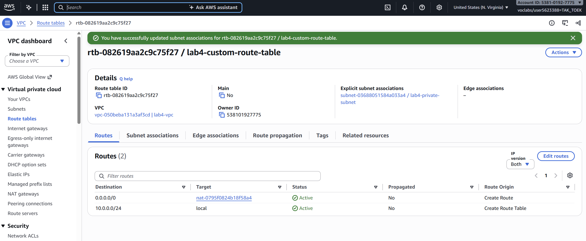

### 10. EC2 instance in the private subnet

Launched `lab4-ec2-02` in `lab4-private-subnet`, using Amazon Linux 2023, 64-bit (x86), instance type `t2.micro`, 8 GiB gp2 storage, and `LabInstanceProfile`. Public IP assignment was disabled. No key pair or inbound security group rules were configured.

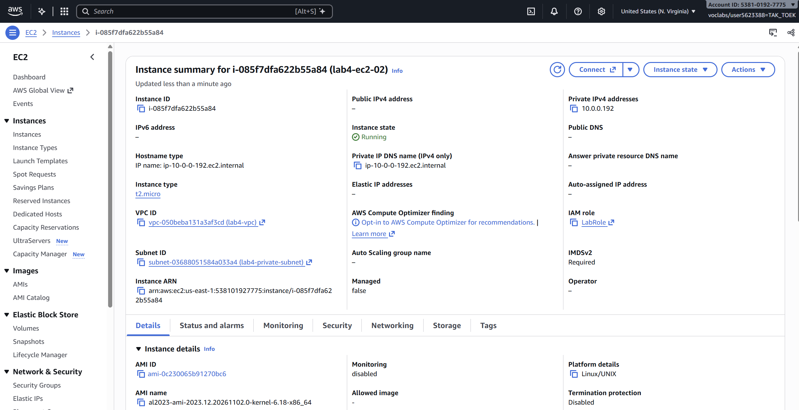

### 11. Internet test from the private subnet

Used Systems Manager Run Command with `AWS-RunShellScript` to run `sudo yum update -y` on `lab4-ec2-02`, with S3 output disabled. The private instance's outbound internet path is:

```text
lab4-ec2-02 → private route table → NAT gateway in public subnet → internet gateway → internet
```

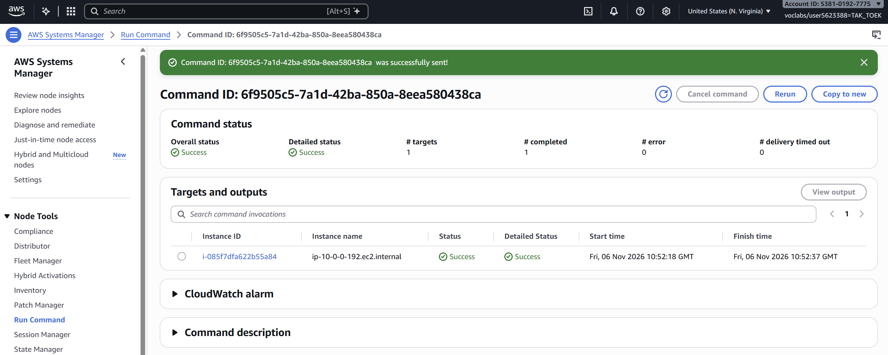

---

## Questions

1. **How many IP addresses does each block contain, and why do the two subnets not overlap?**

   The VPC `10.0.0.0/24` contains 256 IP addresses, from `10.0.0.0` to `10.0.0.255`. Each `/25` subnet contains 128 addresses:
   - `10.0.0.0/25`: `10.0.0.0` to `10.0.0.127`.
   - `10.0.0.128/25`: `10.0.0.128` to `10.0.0.255`.

   They do not overlap because their address ranges are separate. AWS reserves five addresses in each subnet, leaving 123 assignable addresses per subnet.

2. **What makes the public subnet public and the private subnet private?**

   Their associated route tables determine the difference. `lab4-public-subnet` has a default route (`0.0.0.0/0`) directly to the internet gateway. `lab4-private-subnet` has its default route to the NAT gateway instead. The public instance has a public IPv4 address, while the private instance does not. Security groups and network ACLs also control which traffic is allowed.

3. **Why is the NAT gateway placed in the public subnet?**

   The public NAT gateway needs an Elastic IP address and a route to the internet gateway. The public subnet provides this route, allowing the NAT gateway to forward internet traffic from the private instance and return the responses. Placing it in the private subnet without that internet gateway route would not provide internet access.

4. **Can someone on the internet connect to `lab4-ec2-02`? Can it download updates?**

   Someone on the internet cannot initiate a direct connection to the instance in this lab. It has no public IP address, the NAT gateway does not allow unsolicited inbound connections, and its security group has no inbound rules.

   The instance can download updates by initiating an outbound connection through the NAT gateway and internet gateway. The NAT gateway tracks the connection and forwards the response traffic back to the private instance.

5. **Why did the instances need `LabInstanceProfile` for Systems Manager?**

   `LabInstanceProfile` attaches `LabRole` to the instances, providing temporary AWS credentials and permissions for SSM Agent to communicate with Systems Manager, receive commands, and report results. This allows Run Command to execute commands without an SSH key pair or an inbound SSH rule. The instances also need network connectivity to the Systems Manager endpoints.

## Clean up

- [x] Instances terminated.
- [x] NAT gateway deleted and its Elastic IP released.
- [x] Internet gateway detached and deleted.
- [x] `lab4-vpc` deleted. 

